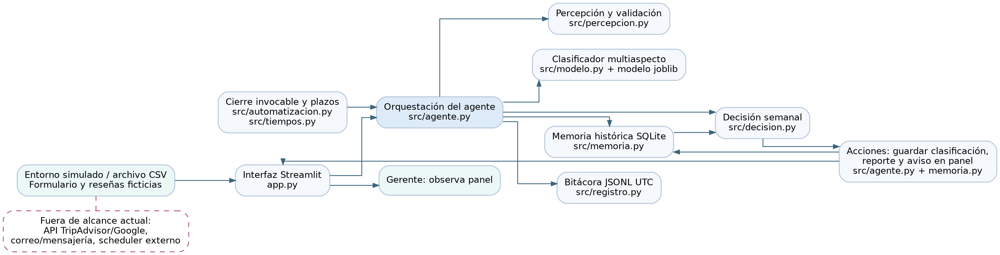
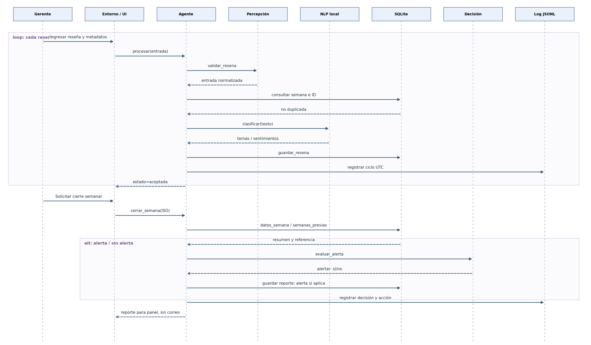
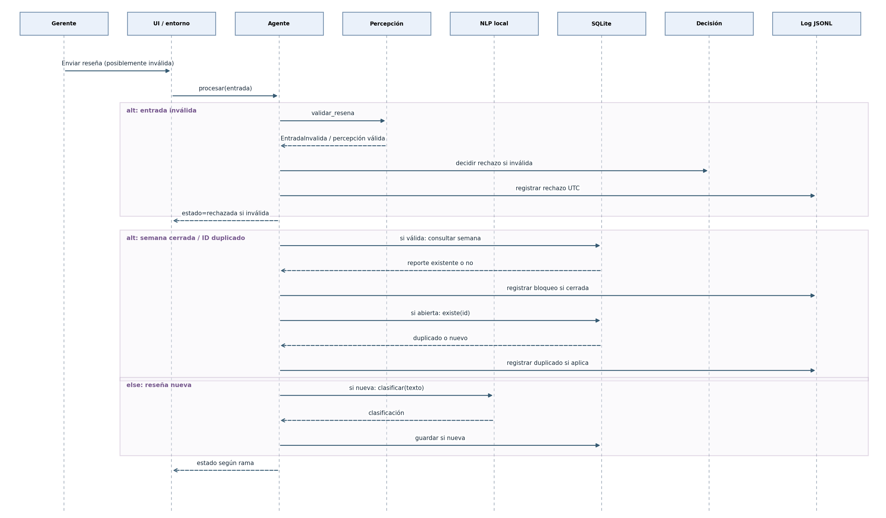

# BORRADOR PARA INSERTAR EN EL DOCUMENTO ORIGINAL · 9. Desarrollo del agente

**Proyecto:** ReviewPulse-Agent · Hotel piloto · Universidad Tecnológica de Bolívar · Inteligencia Artificial.  
**Estado:** borrador de integración documental elaborado a partir del diseño inicial y del código verificado hasta los pasos 1–9. **No sustituye el documento original ni constituye una entrega final.** Deben conservarse las secciones 1–8, agregar primero la Fase 1 y la tabla de cambios, y renumerar las conclusiones como sección 10.

## 9.1. Arquitectura del sistema y componentes IBM

ReviewPulse se implementó como un **agente basado en modelos con orientación a objetivos**. El estado interno no se limita a una percepción: se conserva en SQLite y comprende reseñas, clasificaciones, reportes y alertas por semana. Su ciclo puede rastrearse en `src/agente.py`: `procesar()` valida la percepción, consulta el estado e invoca el clasificador y la acción de persistencia; `cerrar_semana()` recopila los agregados históricos, decide si existe anomalía, almacena el reporte y registra su acción. La meta operacional es informar al gerente, no maximizar una función explícita de utilidad. La clasificación se realiza con un modelo supervisado entrenado previamente, **sin reentrenamiento automático durante la operación**.

El archivo fuente editable del diagrama es `uml/arquitectura.dot`. La conexión con TripAdvisor o Google y el correo **no están implementados**; los orígenes utilizados son formulario, archivo y simulador. El cierre semanal se realiza manualmente o al invocar un proceso independiente, no mediante un servicio residente.

| Componente IBM del diseño, sección 8 | Implementación comprobable | Estado y alcance |
|---|---|---|
| Percepción y manejo de entradas | `src/percepcion.py: validar_resena`, `app.py`, `ejecutar_demo.py` | **Parcial**. Verifica contenido, fecha, origen, estrellas e ID; no dispone de conector API, detección de idioma ni limpieza web completa. |
| Planificación y descomposición de tareas | `src/agente.py: procesar, cerrar_semana`; `src/automatizacion.py: ejecutar_cierre_pendiente` | **Parcial**. Flujo fijo de clasificar → acumular → comparar → registrar; sin planificador autónomo continuo. |
| Memoria | `src/memoria.py: Memoria` (SQLite) | **Implementada localmente**. Guarda reseñas, semanas, alertas y reportes, e impide duplicados. |
| Razonamiento y decisiones | `src/modelo.py: clasificar`; `src/decision.py: evaluar_alerta` | **Implementada con límites**. Predicción multiaspecto + comparación histórica; no dispone de calibración de confianza ni cumple exactitud 85 %. |
| Herramientas y acciones | `src/modelo.py` (joblib/scikit-learn), `src/memoria.py` (sqlite3), `src/registro.py` (JSONL), `src/agente.py` | **Parcial**. Herramientas y servicios locales; sin consumo de APIs externas ni correo. |
| Comunicación | `app.py` (panel), reportes y alertas de `src/agente.py` | **Parcial**. Visualización local; no se ha demostrado entrega al gerente fuera del panel. |
| Aprendizaje y adaptación | `experimentos/paso8`, `experimentos/paso9` (offline) | **No implementado durante la ejecución**, como se declaró en el diseño. Experimentos externos de mejora no actualizan el agente activo. |

## 9.2. Tecnologías

| Tecnología | Versión verificable / requisito del proyecto | Uso real | Justificación frente a alternativa |
|---|---|---|---|
| Python | Versión concreta del equipo **por registrar** mediante `py --version`; recomendación del README: Python 3.11–3.14 | Orquestación, experimentos y CLIs | Ecosistema NLP, fácil reproducibilidad y uso de `unittest`. |
| scikit-learn | `>=1.8,<1.9` en `requirements.txt`; versión instalada por confirmar | Inferencia del clasificador supervisado y entrenamiento experimental | Adecuado para corpus pequeño y CPU; menor exigencia que un transformer grande. |
| Streamlit | `>=1.45,<2` en `requirements.txt`; versión instalada por confirmar | Interfaz de prueba local | Prototipado directo en Python frente a frontend y backend separados. |
| SQLite (`sqlite3`) | Biblioteca estándar de Python; versión del motor por confirmar | Memoria persistente | Sin servidor de base de datos adicional, suficiente para piloto local. |
| joblib | `>=1.3,<2` en `requirements.txt` | Cargar modelo propio `.joblib` | Serialización conveniente con scikit-learn; cargar solo artefactos confiables. |
| numpy / scipy | numpy `>=2,<3`; scipy `>=1.14,<2` | Dependencias de cálculo y aprendizaje | Bibliotecas habituales del ecosistema scikit-learn. |
| JSONL / CSV | Formatos, sin versión de dependencia propia | Registros y evidencia descargable | Archivos auditables mediante herramientas habituales. |
| unittest | Biblioteca estándar de Python | Regresión y pruebas automáticas | Sin dependencias adicionales para el test funcional. |

**Captura pendiente antes de la entrega:** anexar una transcripción de `py --version` y `python -m pip freeze` desde `.venv`, con fechas y hash de artefactos. Los rangos del archivo de dependencias **no son** versiones instaladas.

## 9.3. Entradas, percepciones y sensores

| Entrada | Tipo y rango/formato | Origen del prototipo | Ejemplo |
|---|---|---|---|
| `texto` | `str`, no vacío, longitud ≤10.000 caracteres | Formulario, simulador, CSV | «El servicio fue excelente pero la habitación estaba sucia». |
| `fecha` | `str`, formato ISO `AAAA-MM-DD`, fecha válida | Formulario/archivo/simulador | `2026-10-18` |
| `plataforma` | Cadena enumerada: `formulario`, `archivo`, `simulador` | Control de entrada | `formulario` |
| `estrellas` | Número real de 1 a 5 o ausente | Usuario/archivo/simulador | `4` |
| `id` | Cadena ≤80 caracteres; opcional, autogenerada si falta | Usuario/archivo/simulador | `R-EJEMPLO-001` |
| `semana` | Derivada de `fecha`, semana ISO `AAAA-W##` | Calculada por `src/percepcion.py` | `2026-W42` |
| Historial | Conjuntos de registros SQLite de hasta tres semanas anteriores | Estado local persistente | Totales y proporciones negativas por semana |
| Parámetros de decisión | `Configuracion` de Python: delta negativo 0,30; volumen relativo 1,0 y mínimo 10 reseñas adicionales; mínimo 5 reseñas actuales y 2 semanas históricas | Valores por defecto en `src/decision.py` | 30 puntos porcentuales de aumento |

**Diferencia:** el diseño original mencionaba la parametrización por el gerente y entradas de TripAdvisor/Google. Actualmente el formulario no expone estos umbrales y no se obtiene información directamente de esas plataformas.

## 9.4. Salidas, acciones y efectos observables

| Salida o acción | Módulo / evidencia | Efecto real |
|---|---|---|
| Aceptar/rechazar percepción y normalizar | `src/percepcion.py`, `src/agente.py` | Valida la entrada y devuelve estado, sin guardar datos inválidos. |
| Clasificación por aspecto y polaridad | `src/modelo.py` | Devuelve lista de temas y polaridad por tema; `tema_principal` es nulo con varios temas. |
| Persistir reseña y resultado | `src/memoria.py` → `resenas` | Guarda estado para cálculos posteriores. |
| Cerrar semana y crear reporte | `src/agente.py: cerrar_semana` → `reportes` | Agrega totales, proporción negativa, temas y decisión; bloquea modificaciones posteriores a la semana cerrada. |
| Generar aviso cuando la política alerta | `src/decision.py`, `src/memoria.py` → `alertas` | Guarda aviso en SQLite y lo muestra en panel; **no envía correo**. |
| Registrar ciclo de ejecución | `src/registro.py` | Guarda percepción, decisión y acción con timestamp UTC en JSONL. |
| Cerrar semanas vencidas al invocar ejecutor | `ejecutar_cierre_pendiente.py`, `src/automatizacion.py` | Una pasada por semanas cerrables; requiere activación manual o scheduler externo. |

## 9.5. Diagramas de secuencia UML

**Figura 9.2: escenario típico.** Procesamiento de una o varias reseñas y cierre semanal. Se incluyen participantes externos, interfaz, orquestación, percepción, predicción, decisión, acción, memoria y registros, con `loop` y `alt`.

Fuente editable Mermaid: `uml/secuencia_normal.mmd`.

**Figura 9.3: escenario de excepción.** La entrada inválida se rechaza con log; con una entrada válida, se verifica semana ya cerrada e ID duplicado, y se abstiene de reprocesar. Aparece el fragmento `alt` con las distintas ramas.

Fuente editable Mermaid: `uml/secuencia_excepcion.mmd`. Las figuras esquematizan las llamadas de funciones verificadas en el código; los archivos Mermaid permiten editarlas y conservar sus bloques `alt/loop`.

## 9.6. Diferencias entre diseño e implementación

| Diseño inicial | Implementación actual | Razón e implicación |
|---|---|---|
| Integración con TripAdvisor/Google | Formulario/CSV/simulador | No se implementaron conectores por acceso y alcance del piloto. No afirmar recolección automática. |
| Un tema principal y polaridad global | Conjunto de temas, polaridad por tema y `tema_principal=null` si varios | Las reseñas pueden incluir varios aspectos; `neutro_o_mixto` no equivale siempre a neutral humano. |
| Modelo potente de sentimiento español previsto | Modelos supervisados locales scikit-learn, artefacto entrenado con 292 reseñas | Restricciones de datos/recursos; el objetivo 85 % no se consiguió. |
| Detector de cambio de tono o volumen | Reglas históricas por negatividad y volumen | En Paso 4 se agregó detector de volumen. Umbrales del piloto definidos antes de reevaluar E05, pero el escenario ya era conocido. |
| Mensaje al gerente por correo/mensajería | Aviso exclusivamente dentro de SQLite/Streamlit | No existe prueba de entrega externa. |
| Resumen al cierre de semana dentro de 24 h | Cierre manual o ejecutor de una pasada invocado externamente; registro de tiempos | La fórmula temporal se prueba con seis fechas ficticias; **no hay garantía real de plazo**. |
| Ajuste de umbrales por gerente | Parámetros de la clase `Configuracion` | Interfaz de configuración gerencial no implementada. |
| Aprendizaje a partir de retroalimentación | Experimentos offline independientes | Deliberadamente excluido del agente operativo en esta versión. |

## 9.7. Pruebas frente a las cuatro medidas SMART

**Umbrales originales (sección 7 del diseño):** exactitud estricta de tema + polaridad ≥85 %; detección de cambios anormales dentro de 24 h del cierre; reportes generados y entregados dentro de 24 h del cierre; proporción de alertas falsas <10 %. Las fórmulas operativas se explicitan aquí; las metas temporales expresadas en lenguaje natural se convierten en reglas de 24 h sin alterar su objetivo.

| SMART | Fórmula o regla | Umbral previo | Pruebas, resultado y alcance | ¿Cumple? | Evidencia |
|---|---|---|---|---|---|
| Exactitud de clasificación | reseñas con **todos** los aspectos y polaridades correctos / reseñas evaluadas | ≥85 % | 45/125 = **36,00 %**, Trip-MAML test, etiquetas derivadas por segmentos; test ya consultado en Fase 1 | **No** | `salida_paso6_evaluacion_real/informe_evaluacion.json`, `predicciones_test_reseñas.csv` |
| Detección de cambios dentro de 24 h | anomalías de referencia detectadas con `0 ≤ t_alerta − t_cierre ≤24 h` / anomalías evaluables | 100 % de cambios que superen umbral dentro de plazo según redacción original | Política sintética detectó 15/15 anomalías, pero sin validación temporal de aviso operativo con NLP real; la comprobación temporal aislada solo ensayó la función de latencia | **No acreditado** | `salida_paso4_alertas/*`, `salida_paso4_tiempos/*` |
| Reportes listos y entregados ≤24 h | reportes con generación **y recepción** válidas en ≤24 h / semanas que requerían informe | 100 % de semanas dentro de plazo según redacción original | 6/6 cálculos de latencia simulados correctos; ejecución a demanda, sin entrega externa ni acuse | **No acreditado** | `salida_paso4_tiempos/*`, `salida_app/cierres_automaticos.jsonl` |
| Proporción de alertas falsas | FP / (TP + FP) para alertas **semanales** evaluables | <10 % | 1/(15+1)=**6,25 %** exclusivamente en 30 simulaciones de alertas evaluables con oráculo controlado; no incluye errores NLP reales | **No acreditado integralmente** | `salida_paso4_alertas/metricas_politica.json`, `resultados_ejecuciones.csv` |

**Escenarios y repetición:** 12 escenarios E01–E12 con cinco repeticiones (60 ejecuciones); incluyen normales, límites y cuatro fallas esperadas (texto vacío, fecha imposible, ID repetido, fecha faltante). Las medias y desviaciones estándar por escenario están en `salida_paso4_alertas/resumen_por_escenario.csv`. Existen además 6 casos temporales T01–T06 de cálculo de plazos. La comparación de umbrales experimental del Paso 9 **no** se mezcla con la tasa de alertas del SMART.

### Análisis de resultados (mantener dentro de una página en el PDF final)

El agente cumple las pruebas funcionales automatizadas (49/49 en el Paso 8 más 8/8 pruebas independientes, y 9/9 del Paso 9), conserva memoria y ejecuta el ciclo percepción–decisión–acción, pero el modelo de lenguaje **no alcanza** la exactitud SMART: 45 de 125 reseñas completas coincidieron estrictamente en aspectos y polaridades (36 %). Una causa probable es la combinación de reseñas multiaspecto, sentimientos mixtos, desbalance de clases y un conjunto de entrenamiento limitado (292 reseñas). La auditoría detectó omisiones frecuentes de críticas negativas. La alternativa de detector binario desarrollada fuera de línea obtuvo precisión 65,12 % y recall 50 % en validación cruzada sobre entrenamiento; no se integró porque también produce señales falsas. En el Paso 9, reducir retrospectivamente su umbral de 0,50 a 0,45 elevó las quejas detectadas de 28 a 40, pero aumentó las falsas señales de 15 a 40; no se trata de falsos avisos semanales. La política de alertas sí respondió correctamente a aumentos de volumen y negatividad en una simulación con oráculo controlado: 15 TP, 1 FP, 0 FN y 14 TN. Su proporción de alertas falsas (6,25 %) es prometedora **solo para ese entorno**, y no acredita la operación con clasificaciones reales. Las seis pruebas temporales corroboraron la fórmula de 24 horas, pero no la programación de ejecuciones ni la entrega al gerente. Para corregir las debilidades se propone recolectar un conjunto etiquetado independiente más amplio y equilibrado, mejorar la clasificación de quejas mixtas y probar el sistema extremo a extremo; luego incorporar programación supervisada de cierres, canal real de entrega y evidencias de recepción.

## 9.8. Limitaciones y trabajo futuro

- Datos de prueba disponibles, no reseñas del hotel piloto real ni conexión a plataformas externas.
- La exactitud del modelo real está por debajo de la meta y la evaluación de prueba ya se inspeccionó en exploraciones previas.
- El entorno simulado es estocástico, pero la clasificación NLP activa se mantiene determinista y no se reentrena en línea.
- La hora de cierre se representa de manera provisional por semana ISO en UTC; verificar zona horaria del hotel antes de operación real.
- Las alertas se almacenan localmente, sin envío externo ni acuse.
- No hay programador recurrente instalado; el ejecutor actúa solo cuando se invoca.
- Los textos y metadatos quedan guardados en SQLite y JSONL: no publicar información personal sin autorización.
- No confundir pruebas unitarias y simuladas con validación SMART extremo a extremo.

## 9.9. Enlaces y evidencias (pendiente de completar por el equipo)

- Repositorio GitHub o equivalente: **PENDIENTE DE PUBLICAR Y VERIFICAR**.
- Evidencia: elegir **plataforma pública estable** o **video ≤20 minutos con cámara y voz de ambas integrantes**, con índice de minutos, demo desde cero, caso de error, ejecución y resultados.
- Archivos de apoyo: `requirements.txt`, `README.md`, ZIP del corpus original (descarga por separado, si licencia lo permite), resultados y logs de pasos 4, 6, 8 y 9, más bitácora de uso de IA.

## 10. Conclusiones (propuesta de actualización, no reemplaza automáticamente la original)

ReviewPulse demuestra una implementación local auditable de un agente basado en modelos con orientación a objetivos. Integra clasificación multiaspecto en español, memoria persistente, comparación histórica, reportes y alertas visibles en panel. En pruebas de software y simulación se verificó el ciclo percepción–decisión–acción y se detectó el problema de volumen, que después se corrigió. La evaluación sobre 125 reseñas completas mostró una exactitud estricta del 36 %, por debajo de la meta inicial de 85 %, y pone de manifiesto la necesidad de mejorar la calidad del análisis de sentimiento antes de considerar el sistema fiable para decisiones hoteleras. Asimismo, las marcas de tiempo y los cálculos de latencia no equivalen aún a automatización ni a entrega confirmada dentro de 24 h. El prototipo es técnicamente reproducible en un entorno local, con limitaciones explícitas y una ruta de mejoras medibles, pero requiere despliegue, evaluación integral y canal de notificación para considerarse operativo.
